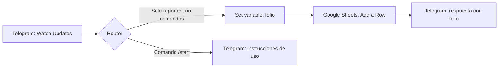
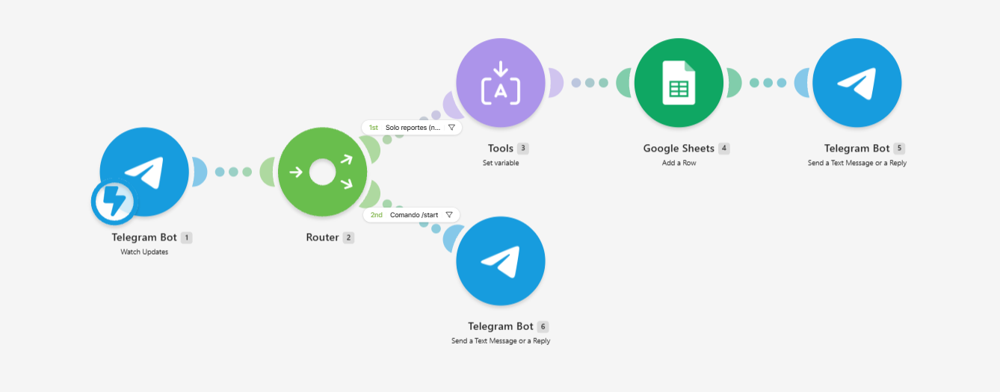
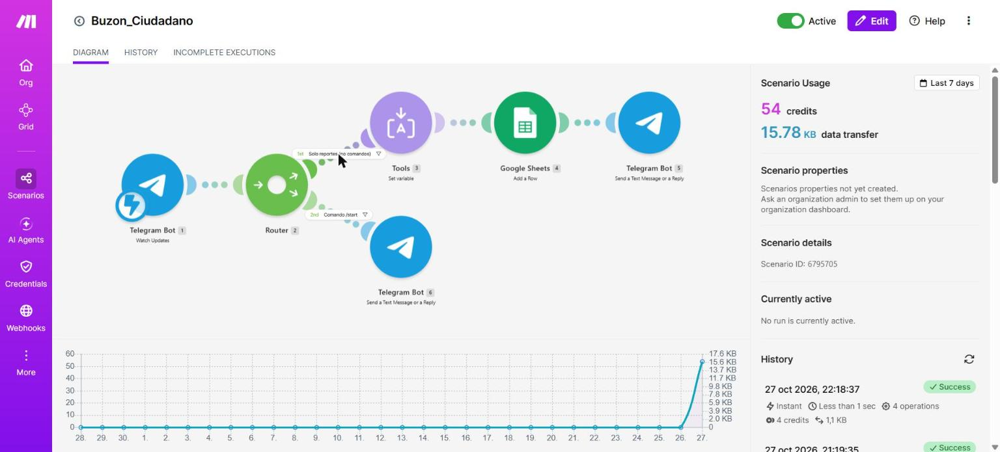
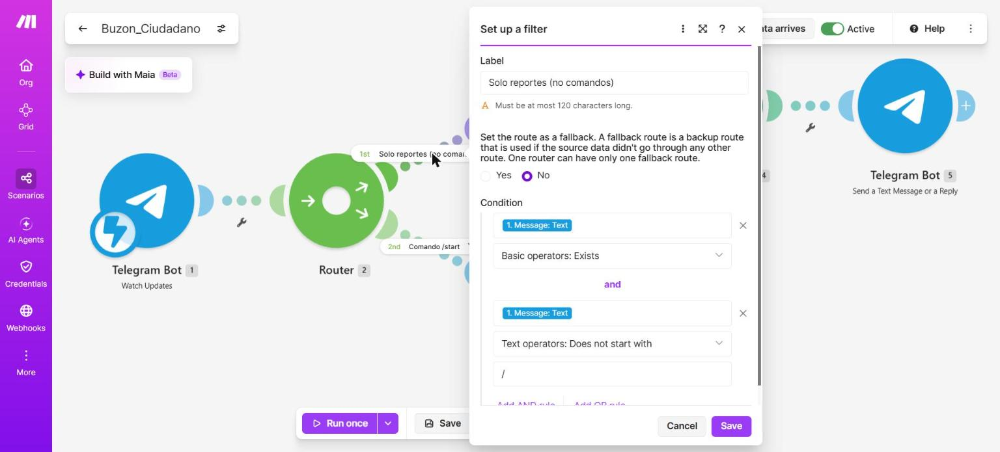
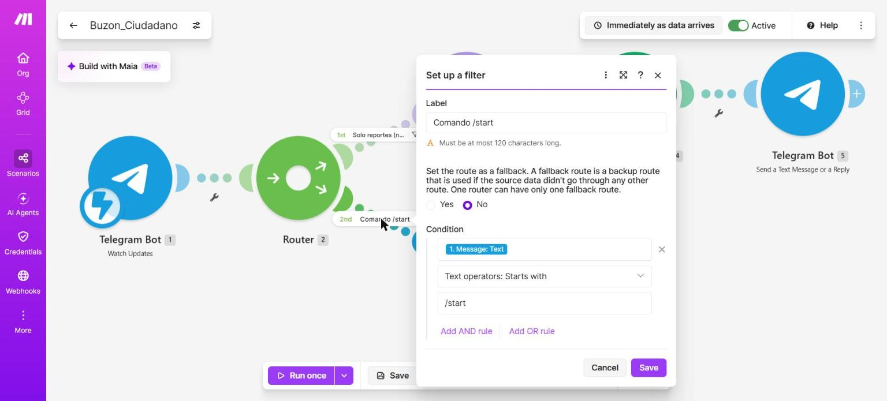
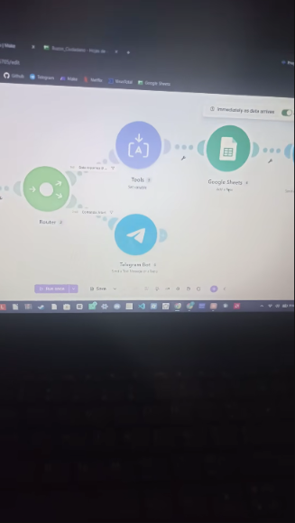
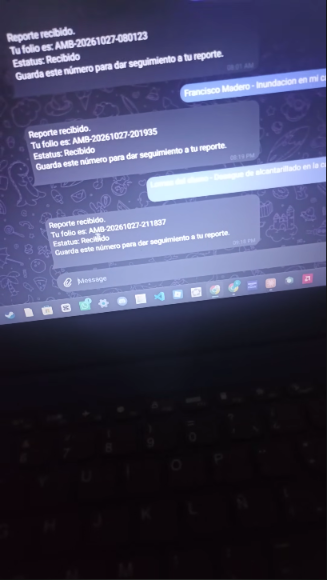
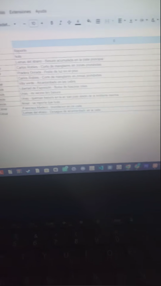

# Práctica 3.1 – Buzón ciudadano con folio

Reporte técnico de la práctica **3.1 Sociedad, organización social**, de la materia **Desarrollo Sustentable (ACD-0908)**.

| Campo | Detalle |
| --- | --- |
| Alumno | Cesar Jesus Gamez Mendoza |
| Carrera | Ingeniería en Sistemas Computacionales, Tecnológico Nacional de México, Campus Mazatlán |
| Unidad y tema | 3. Escenario socio-cultural, 3.1 Sociedad, organización social |
| Práctica | 3.1-P4 Buzón ciudadano con folio (trabajo individual) |
| Herramientas | Telegram (BotFather), Make y Google Sheets |
| Fecha de las pruebas | 27 de octubre de 2026 |

## Contenido del repositorio

```text
.
├── README.md                    Reporte técnico (este archivo)
├── codigo/
│   └── blueprint.json           Escenario de Make exportado
├── imagenes/                    Capturas del escenario, filtros y pruebas
├── video/
│   └── enlace.txt               Enlace al video en YouTube con la prueba en vivo
└── resultados/
    └── Resultados.pdf           Documento con lo aprendido en la práctica
```

## Objetivo

Identificar qué organizaciones de Mazatlán atienden los problemas ambientales y construir, sin programar, un buzón ciudadano automatizado que registre reportes con fecha, usuario y folio, para reflexionar sobre el valor de la participación ciudadana formal.

## Cómo funciona

Un ciudadano escribe su reporte al bot de Telegram. Make recibe el mensaje, crea un folio, guarda una fila en Google Sheets y responde con el folio. Si el mensaje es un comando, no se registra.



### Módulos del escenario `Buzon_Ciudadano`

| N.º | Módulo | Función |
| --- | --- | --- |
| 1 | Telegram Bot, Watch Updates | Recibe cada mensaje que llega al bot mediante un webhook. |
| 2 | Router | Separa el camino de los reportes del camino del comando `/start`. |
| 3 | Tools, Set variable | Crea la variable `folio` con el formato `AMB-AAAAMMDD-HHmmss`, usando la zona horaria America/Mazatlan. |
| 4 | Google Sheets, Add a Row | Agrega una fila en la hoja `Buzon_Ciudadano`, pestaña `Reportes`. |
| 5 | Telegram Bot, Send a Text Message or a Reply | Responde al ciudadano con el folio y el estatus. |
| 6 | Telegram Bot, Send a Text Message or a Reply | Responde las instrucciones de uso cuando el usuario envía `/start`. |

### Filtros del Router

| Ruta | Nombre del filtro | Condición |
| --- | --- | --- |
| 1 | Solo reportes (no comandos) | `Message: Text` existe **y** `Message: Text` no empieza con `/` |
| 2 | Comando /start | `Message: Text` empieza con `/start` |

### Mapeo de la hoja de registro

La pestaña `Reportes` tiene en la fila 1 los encabezados `Folio`, `Fecha`, `Usuario`, `Nombre`, `Reporte` y `Estatus`.

| Columna | Valor |
| --- | --- |
| Folio | `{{3.folio}}` |
| Fecha | `{{formatDate(now; "DD/MM/YYYY HH:mm"; "America/Mazatlan")}}` |
| Usuario | `{{1.message.from.username}}` |
| Nombre | `{{1.message.from.first_name}}` |
| Reporte | `{{1.message.text}}` |
| Estatus | `Recibido` (texto fijo) |

### Respuesta del bot

```text
Reporte recibido.
Tu folio es: {{3.folio}}
Estatus: Recibido
Guarda este número para dar seguimiento a tu reporte.
```

## Cómo reproducirlo

1. En Telegram, abrir `@BotFather`, enviar `/newbot` y crear el bot `Buzón Ambiental`.
2. Crear en Google Sheets la hoja `Buzon_Ciudadano`, renombrar la pestaña como `Reportes` y escribir los encabezados de la fila 1.
3. En Make, crear una conexión de Telegram con el token del bot y una de Google Sheets con la cuenta dueña de la hoja.
4. Importar `codigo/blueprint.json` en un escenario nuevo (menú de los tres puntos, *Import Blueprint*) y volver a elegir las conexiones, el webhook y la hoja en cada módulo.
5. Activar el escenario y enviar `/start` al bot para probarlo.

## Seguridad

- El **token del bot no está en este repositorio**: se guardó únicamente dentro de la conexión de Make.
- El blueprint solo contiene identificadores internos de Make; no incluye contraseñas ni claves.
- En las capturas y en el video no se muestra el token ni las pantallas de BotFather.

## Imágenes del escenario



*Escenario completo, de izquierda a derecha: Watch Updates, Router, Set variable, Add a Row y respuesta. Debajo del Router, la ruta del comando `/start`.*



*Escenario activo en Make con las etiquetas de los filtros sobre las rutas del Router.*



*Filtro “Solo reportes (no comandos)”: el texto existe y no empieza con `/`.*



*Filtro “Comando /start”: el texto empieza con `/start`.*

## Video

El video con la prueba en vivo está en YouTube: <https://youtube.com/shorts/Z1nPwHmsXM0> (el mismo enlace está en `video/enlace.txt`).

| Escenario en Make | Respuesta con folio | Hoja de registro |
| --- | --- | --- |
|  |  |  |

## Actividad 1. ¿Quién atiende los problemas ambientales en Mazatlán?

| Organización | Tipo | Qué problemas atiende | Cómo se reporta | ¿Entrega folio? | Fuente |
| --- | --- | --- | --- | --- | --- |
| PROFEPA | Federal | Incumplimiento de la normatividad ambiental: contaminación, recursos naturales, flora y fauna. | En línea (botón “Haz tu denuncia”), correo denuncias@profepa.gob.mx, teléfono 800 PROFEPA (7763372, se ratifica en 3 días hábiles) o en la Oficina de Representación del estado. | La página no menciona un folio; informa el trámite mediante oficio y se da seguimiento sobre el expediente. | [profepa.gob.mx](https://www.profepa.gob.mx/innovaportal/v/4991/1/mx/31_como_puedes_denunciar.html) |
| SEBIDES (Secretaría de Bienestar y Desarrollo Sustentable de Sinaloa) | Estatal | Vigilancia e inspección ambiental, contaminación y quema de soca. | En las notas oficiales consultadas no aparece un canal para denunciar (por verificar). | No se encontró información. | [sinaloa.gob.mx](https://sinaloa.gob.mx/quema-de-soca-sera-sancionado-en-sinaloa-sebides/) |
| H. Ayuntamiento de Mazatlán, Dirección de Ecología y Medio Ambiente | Municipal | Quejas y denuncias ciudadanas en materia ambiental dentro del municipio. | Por teléfono a la Dirección: 669 982 84 52 (directorio oficial). El detalle del trámite no se pudo consultar. | Por verificar. | [mazatlan.gob.mx](https://mazatlan.gob.mx/directorio/ecologia-y-medio-ambiente/) |
| JUMAPAM | Municipal | Fugas, derrames y desbordamientos de aguas residuales, servicio de agua y drenaje. | Aquatel 073 o 669 915-70-00, formulario web o correo jumapam@jumapam.gob.mx. | La página no indica si entrega folio. | [jumapam.gob.mx](https://jumapam.gob.mx/index.php/servicios/quejas-o-sugerencias) |
| Maz Conciencia, A.C. | Social | Limpieza de playas y manejo de residuos. | No se encontró un canal formal de reportes (nota de 2020, vigencia por verificar). | No | [Sonplayas](https://sonplayas.com/comunidad/acciones-ciudadanas-a-favor-de-la-naturaleza-2020/) |

Donde la fuente no daba un dato se escribió “no se encontró” o “por verificar” en lugar de suponerlo.

## Resultados de las pruebas

Se registraron 9 mensajes en la hoja (1 de prueba y 8 reportes). Todos recibieron folio y estatus “Recibido”. Se omiten los nombres de quienes reportaron.

| Folio | Hora | Problema reportado |
| --- | --- | --- |
| AMB-20261027-073218 | 7:32 | Mensaje de prueba (“hola”) |
| AMB-20261027-073602 | 7:36 | Basura acumulada en la calle principal |
| AMB-20261027-075805 | 7:58 | Corte de manglares en zonas prohibidas |
| AMB-20261027-075830 | 7:58 | Poste de luz caído |
| AMB-20261027-080114 | 8:01 | Corte de manglares en zonas prohibidas |
| AMB-20261027-080123 | 8:01 | Alcantarillado en las calles |
| AMB-20261027-081734 | 8:17 | Bolsas de basura rotas |
| AMB-20261027-082406 | 8:24 | Vecino que tira basura |
| AMB-20261027-082501 | 8:25 | Quema de basura en una avenida |

El problema más repetido fue la basura y su quema, con 4 de los 8 reportes.

## Comparación con un sistema oficial

Se tomó como referencia la denuncia ante PROFEPA. Según su página oficial, el denunciante proporciona nombre, domicilio, teléfono y correo, describe los hechos, indica la ubicación y puede anexar fotos, videos o documentos. Si llama por teléfono tiene 3 días hábiles para ratificar, y puede pedir que su identidad se mantenga en reserva.

| Aspecto | Denuncia ante PROFEPA | Buzón de Telegram y Make |
| --- | --- | --- |
| Datos que pide | Identificación y contacto, hechos, ubicación, evidencias | Solo texto libre; guarda usuario y nombre de Telegram |
| Folio | La página no menciona un folio; sí se radica un expediente | Folio automático `AMB-AAAAMMDD-HHmmss` |
| Seguimiento | Oficio y consulta del expediente en la oficina | El estatus queda fijo en “Recibido”; nadie lo actualiza |
| Quién recibe | Autoridad con facultades legales | El alumno; no hay autoridad que responda |
| Plazo y respuesta | Procedimiento administrativo con ratificación y oficio | No hay plazo ni respuesta |

Al buzón le faltan: ubicación y evidencia, un responsable que reciba y responda, un plazo de atención, estados de seguimiento que cambien y la forma de consultar el avance con el folio. Con el Router, el comando `/start` responde con instrucciones de uso en lugar de registrar el mensaje.

## Preguntas de reflexión

**1. ¿Por qué es importante que un reporte ciudadano reciba un folio? ¿Qué pasa con los reportes que se hacen solo de palabra o en redes sociales?**

El folio convierte un aviso en un registro: tiene fecha, contenido y un número único con el que la persona puede dar seguimiento y exigir una respuesta. También permite a la institución contar y priorizar los casos. Un reporte hecho solo de palabra o en redes sociales no queda registrado en ningún sistema, no hay a quién reclamarle y se pierde entre otras publicaciones; puede generar atención por presión social, pero no hay obligación de responder ni forma de comprobar que se recibió.

**2. De las organizaciones que investigaron, ¿cuál les pareció más accesible para un ciudadano y cuál menos? ¿Por qué?**

La más accesible fue JUMAPAM, porque ofrece varias vías sencillas (teléfono Aquatel, formulario web y correo) para problemas cotidianos como fugas y derrames. PROFEPA también ofrece varias vías (línea 800, correo y en línea), pero el trámite es más formal: pide datos personales, descripción de hechos y, si se llama, ratificar en 3 días hábiles. La menos accesible fue la instancia estatal (SEBIDES), porque en las fuentes consultadas no se encontró un canal claro para denunciar; algo parecido pasa con la asociación civil, que no tiene un procedimiento formal de reportes. La del municipio publica un teléfono en su directorio, pero no se pudo confirmar el detalle de su trámite de quejas.

**3. ¿Qué problemas ambientales se repitieron más en los reportes del grupo? ¿Qué organización debería atender cada uno?**

De los 8 reportes reales (sin contar el mensaje de prueba), el problema que más se repitió fue la basura y su quema: 4 reportes (basura acumulada, bolsas rotas, un vecino que tira basura y quema de basura en una avenida). Le siguió el corte de manglares en zonas prohibidas con 2 reportes, y hubo 1 de alcantarillado y 1 de un poste de luz caído. La basura y su quema le corresponden a la Dirección de Ecología y Medio Ambiente del Ayuntamiento, con apoyo del servicio municipal de limpia; el corte de manglares, por ser un ecosistema protegido, a PROFEPA; el alcantarillado a JUMAPAM; y el poste de luz al área de alumbrado público del municipio, ya que no es un problema ambiental sino de servicios públicos.

**4. ¿Quién puede quedar fuera de un buzón digital como el suyo (por edad, acceso a internet o idioma)? ¿Cómo afecta eso a la equidad en la participación ciudadana?**

Pueden quedar fuera las personas mayores o con poca habilidad digital, quienes no tienen celular con datos o Telegram instalado, las personas con discapacidad visual o motriz si el bot no es accesible, y quienes hablan una lengua indígena o no leen con soltura, ya que el bot solo funciona por texto y en español. Esto afecta la equidad porque los problemas de las colonias con menos conectividad no llegan al registro, y las decisiones se toman con información de quienes ya tienen más acceso. Un buen canal debería combinar medios digitales con teléfono y atención presencial.

**5. ¿Qué tendría que pasar para que su buzón fuera un canal formal y no solo un registro? Piensen en quién recibe el reporte, quién responde y en qué plazo.**

Tendría que haber una institución o responsable designado que reciba los reportes (por ejemplo, el área de Ecología del municipio), con personas encargadas de revisarlos y canalizarlos a la dependencia competente; un plazo de respuesta definido (por ejemplo, acuse en 24 horas y respuesta de fondo en un número de días hábiles); estados de seguimiento que se actualicen y se puedan consultar con el folio; y protección de los datos personales de quien reporta. Además, el reporte necesitaría ubicación y evidencia, y la institución debería publicar resultados para rendir cuentas.

## Conclusión

El buzón demostró que automatizar el registro con folio es posible sin programar, pero también que un registro no equivale a un canal formal: sin una autoridad que responda, un plazo y seguimiento, el folio solo comprueba que el mensaje fue recibido por el bot. Participar de manera formal implica conocer qué dependencia atiende cada problema y exigir respuesta con un folio.

Más detalle de lo aprendido en [`resultados/Resultados.pdf`](resultados/Resultados.pdf).
